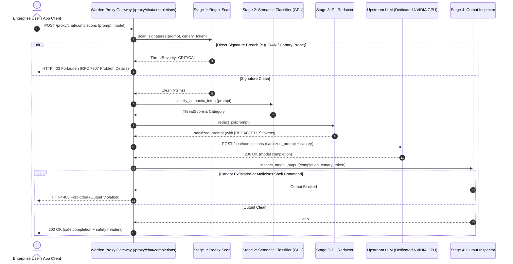
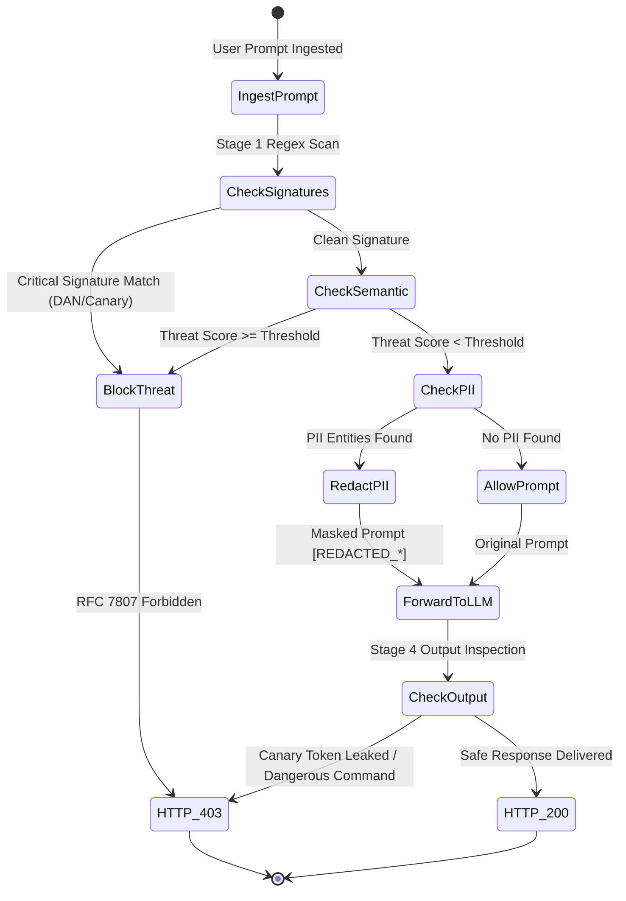

# System Architecture & Technical Design

## 1. Overview
**Warden** is an enterprise runtime security and policy firewall for Large Language Model (LLM) applications. It intercepts inbound user queries and outbound model responses to detect adversarial prompt injection attacks, persona hijacking jailbreaks (DAN, Developer Mode, roleplay manipulation), sensitive PII leakage (SSNs, credit cards, API keys), and system prompt canary exfiltration.

---

## 2. C4 Container Diagram

```mermaid
flowchart TD
    subgraph Clients ["Client Applications"]
        UserBrowser["Security Analyst Browser\nPort 3003"]
        AppClient["Enterprise Chat Application\n(SDK / API Client)"]
    end

    subgraph Warden_Firewall ["Warden Firewall Stack"]
        Frontend["Warden SOC UI (React 19 + Tailwind v4)\nPort 3003"]
        Gateway["Warden FastAPI Gateway & Reverse Proxy\nPort 8003"]

        subgraph Inspection_Pipeline ["Multi-Stage Inspection Engine"]
            Stage1["Stage 1: Regex & Signature Pre-Filter\n(<5ms budget)"]
            Stage2["Stage 2: Zero-Shot Semantic Classifier\n(Ollama GPU Inference)"]
            Stage3["Stage 3: PII Entity Redaction\n(Typed Masking)"]
            Stage4["Stage 4: Output Leakage Checker\n(Canary & Command Guard)"]
        end

        PolicyEngine["Policy & Audit Engine\n(BLOCK / REDACT / FLAG / ALLOW)"]
        Store[("In-Memory & Audit Incident Log\nTraffic Telemetry Stream")]
    end

    subgraph Upstream_LLMs ["Inference Backends"]
        LocalGPU["Local NVIDIA Dedicated NVIDIA GPU\nOllama: qwen2.5:0.5b (Warm)"]
        CloudLLM["Cloud Failover LLM\n(OpenAI / Anthropic)"]
    end

    UserBrowser --> Frontend
    Frontend --> Gateway
    AppClient -->|POST /proxy/chat/completions| Gateway

    Gateway --> Stage1
    Stage1 --> Stage2
    Stage2 --> Stage3
    Stage3 --> PolicyEngine

    PolicyEngine -->|Threat Neutralized (403)| AppClient
    PolicyEngine -->|Sanitized Prompt| LocalGPU
    PolicyEngine -->|Fallback| CloudLLM

    LocalGPU --> Stage4
    Stage4 --> AppClient
    PolicyEngine --> Store
```

---

## 3. Reverse-Proxy Inspection Sequence



---

## 4. Threat Action State Machine


