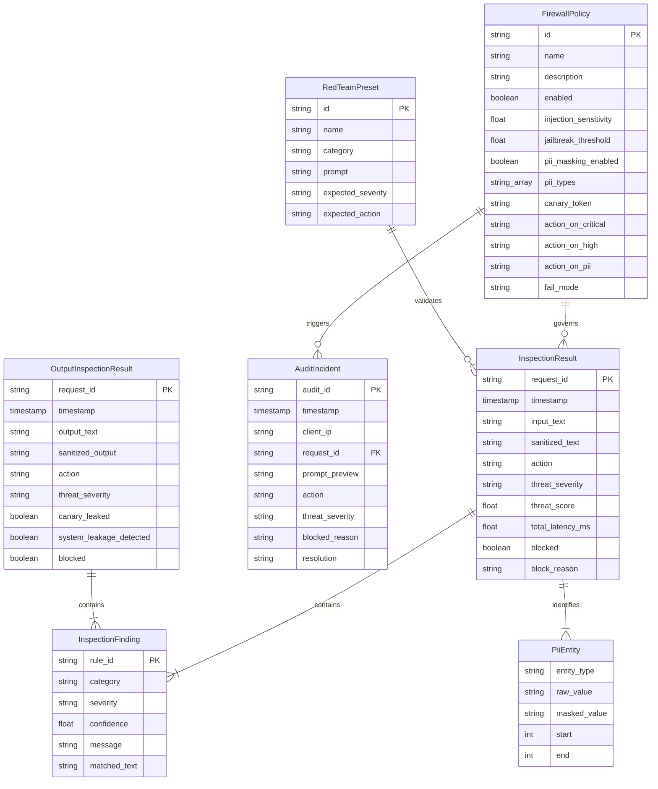

# Data Model & Entity Specifications

## 1. Entity Relationship Diagram (ERD)

---

## 2. Threat Severity & Category Matrix

| Threat Category | Default Severity | Inspection Stage | Description |
| :--- | :---: | :---: | :--- |
| `PROMPT_INJECTION` | `CRITICAL` / `HIGH` | Stage 1 & Stage 2 | Direct or indirect attempts to override instructions or redefine system boundaries. |
| `JAILBREAK` | `CRITICAL` | Stage 1 & Stage 2 | Persona hijacking exploits (DAN, Developer Mode, Grandparent roleplay). |
| `CANARY_EXTRACTION`| `CRITICAL` | Stage 1 & Stage 4 | Probing or exfiltrating secret session canary tokens. |
| `PII_LEAKAGE` | `MEDIUM` | Stage 3 | Transmission of personal identifiable data (SSN, credit card, email, phone, API key). |
| `SYSTEM_LEAKAGE` | `HIGH` | Stage 1 & Stage 4 | Probing or outputting hidden system prompt instructions. |
| `HARMFUL_ADVICE` | `CRITICAL` | Stage 2 & Stage 4 | Destructive shell commands (`rm -rf /`) or physical hazard instructions. |
| `BENIGN` | `SAFE` | - | Standard user query satisfying enterprise safety policy. |
